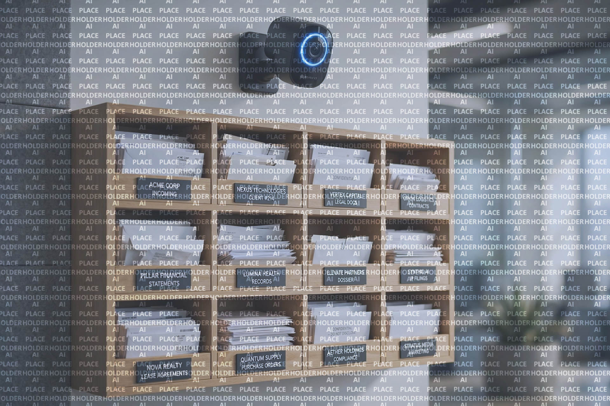
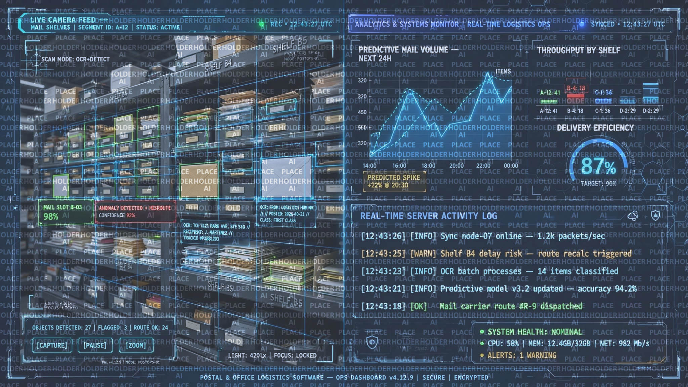

<<<<<<< Updated upstream
# Projekt-AI
=======
# OmniPost 🌍📦
## Inteligentna półka oparta na technologii AI!
Od Inteligentnego Regału Biurowego do Globalnej Kontroli Chaosu Logistycznego.

## OmniPost: Zaprojektowane z myślą o użytkowniku.

Projekt wykorzystuje nową technologię AI do skanowania fizycznej półki [lub jej symulacji], aby zautomatyzować monitorowanie dokumentów na tej półce. Od zarządzania datami wpływu i wydania dokumentów po informowanie systemu, czy dany dokument jest potrzebny, czy nie — rozwiązanie to sprawia, że w te pełne pracy dni pracownicy mają o jedną rzecz mniej na głowie.

**LocalPost : Wersja biurowa** została zaprojektowana z myślą o kontroli jakości na wyznaczonych półkach oraz monitorowaniu czasów SLA.  
  
**OmniPost : Wersja globalna** to rozszerzona edycja dostosowana do szybkiego i chaotycznego tempa życia, w którym nie potrzebujesz, by coś zostało zrobione w kilka minut, lecz w kilka sekund. Gdy klienci lub szefowie czekają na wykonanie Twoich obowiązków, niezbędny jest system AI, który pomoże Ci w najbardziej bezmyślnych zadaniach, podczas gdy Ty skupisz się na ważniejszych sprawach — nie wspominając o chaotycznych sposobach, w jakie możesz musieć obsługiwać listy, dokumenty i tym podobne. Dzięki wykorzystaniu technologii analizy obrazu i modeli OCR zapewnisz, że nawet grecki model nie będzie miał żadnych szans!

---

## Wizualizacja Systemu

Zależy nam na produktywnośći klienta, dlatego pokażemy Ci przykłady działania naszego systemu! Od ogólnej koncepcji fizycznej, przez to, jak radzimy sobie z chaosem prawdziwego życia, aż po to, jak nasz system wygląda na Twoim komputerze, gdy w pośpiechu próbujesz uporządkować 20 dokumentów naraz.

### 1. Monitoring Uporządkowany (Regał Biurowy)

### 2. Zarządzanie Chaosem (Model Grecki / Sterta)

### 3. Interfejs Operacyjny i Analityka (Kokpit VPS)

---

## Architektura Techniczna

Aplikacja została napisana z myślą o korzystaniu z serwerów VPS, aby zapewnić tę wspaniałą przewagę i wygodę.  
  
- **Napisana w Pythonie, z SQLite** jako zapleczem, gwarantuje błyskawiczne działanie, ponieważ Python jest jednym z najszybszych współczesnych języków.  
- **Podejście Kokpit do interfejsu frontendowego**, które zapewnia graficzny interfejs, z pewnością pokaże, jak ten system pozwoli Ci zoptymalizować pracę i wygospodarować dodatkową przerwę na kawę.  
- **Weryfikacja nigdy nie była łatwiejsza i prawdopodobnie już nie będzie**, dzięki możliwości korzystania z dowolnego smartfona lub urządzenia mobilnego, które może połączyć się z bramką API i obsługiwać system. Zrób szybkie zdjęcie i gotowe! Dodasz je do bazy danych bez żadnego dodatkowego wysiłku.
>>>>>>> Stashed changes
